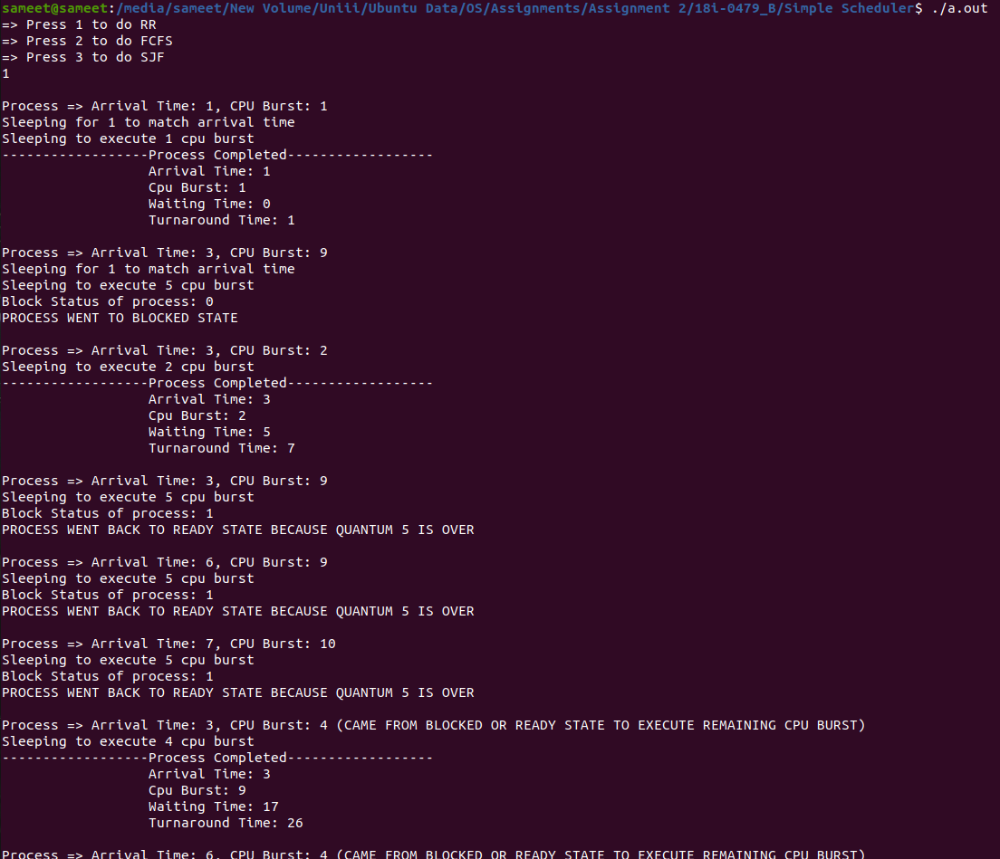
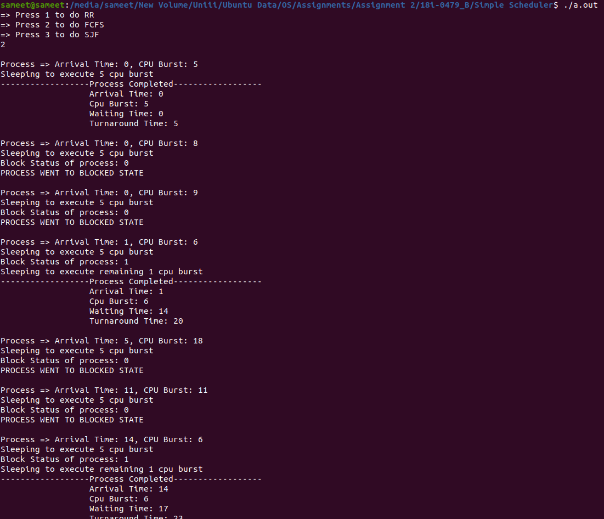
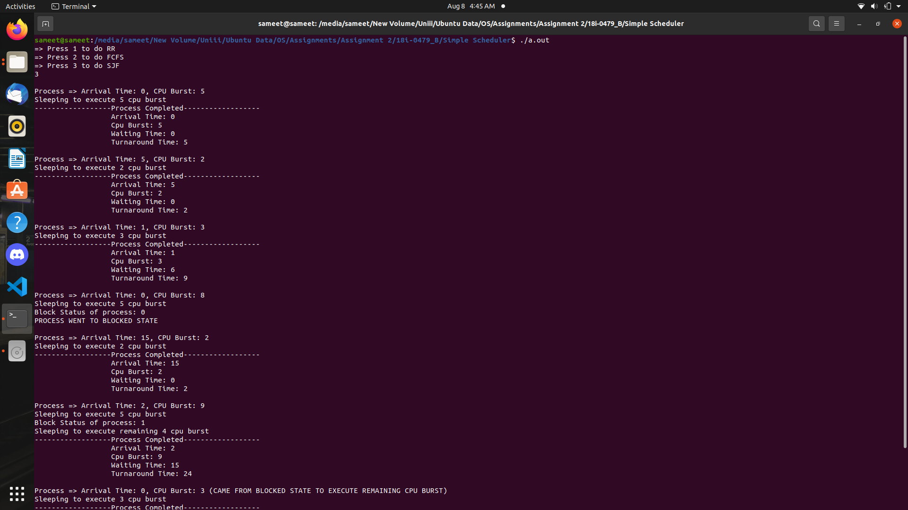

# Five-State CPU Scheduling Simulator

A Linux C++ simulation of the operating-system process lifecycle. Instead of representing states only as objects, the project implements **new, ready, running, blocked, and exit as separate Unix processes** connected with pipes and named FIFOs.


## Scheduling algorithms

- First-Come, First-Served (FCFS)
- Shortest Job First (SJF)
- Round Robin (RR) with a configurable quantum

## Systems concepts demonstrated

- Five-state process lifecycle
- `fork` and `exec` process creation
- Anonymous pipes and named FIFOs
- File-descriptor manipulation with `dup`/`dup2`
- Inter-process transfer of process-control data
- Ready queues, CPU bursts, blocking, and completion
- Throughput, waiting-time, and turnaround-time reporting

See [Architecture](docs/ARCHITECTURE.md) for the responsibilities of each executable and their communication flow.

## Build and run

The simulator uses POSIX APIs and should be built on Linux.

```bash
make
make run
```

`make` creates six executables and copies the sample workloads into `build`. `make run` starts the simulator from that directory so its cooperating executables and input files resolve correctly.

Select an algorithm from the interactive menu. Results are written to `build/processes_stats.txt`.

## Workload format

The repository includes clearly named workloads for Round Robin, FCFS, and SJF in `examples`.

- The first line identifies the scheduling algorithm.
- The second line provides the Round Robin quantum where applicable.
- Each remaining line defines a process number, arrival time, and required CPU burst.

Generated executables, FIFOs, and result files are intentionally excluded from version control.

## Screenshots

| Simulation | State transitions |
| --- | --- |
|  |  |



## Project status

This repository preserves the original operating-systems project. The application logic remains intact; repository changes focus on reproducible compilation, portability, documentation, and generated-file hygiene.

## License

Licensed under the [MIT License](LICENSE).
